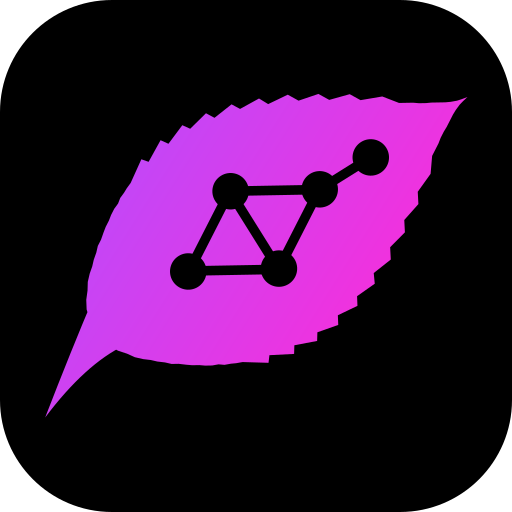

#  irch

Private, peer-to-peer community chat shaped like Discord, with no server:
spaces, channels, threads, DMs, voice and video calls. A small Rust core on
[iroh](https://iroh.computer), a terminal client, and one app for desktops,
Android and iPhones.

## Install

Each keeps itself up to date.

```sh
irm https://github.com/cab-ucf/irch/releases/latest/download/install.ps1 | iex  # Windows
curl -fsSL https://github.com/cab-ucf/irch/releases/latest/download/install.sh | sh  # macOS, Linux
```

- **Android**: open [irch.apk](https://github.com/cab-ucf/irch/releases/latest/download/irch.apk)
  on the phone, or track this repo in [Obtainium](https://obtainium.imranr.dev).
- **iPhone**: [irch.ipa](https://github.com/cab-ucf/irch/releases/latest/download/irch.ipa)
  in [AltStore](https://altstore.io) or [SideStore](https://sidestore.io)
  (updated by hand), or TestFlight once releases have an App Store
  Connect key.
- **Storage node** (always on): a space's *Storage Nodes → Run one on this
  computer*, or `install.sh … | sh -s -- --server`.
- **NixOS**: `inputs.irch.url = "github:cab-ucf/irch";` and
  `irch.nixosModules.default` among the modules: the app and a storage
  node, kept up to date (checked against irch's key, built by Nix).
  `services.irch.enable = false;` leaves the node out.
- **From source**: `cargo run --release -p irch` (terminal, `--serve` for a
  storage node); `cd app && cargo tauri dev` or
  `cargo tauri android build --apk`; on a Mac, `cargo tauri ios init`,
  then `cargo tauri ios dev`. Linux needs webkit2gtk-4.1, gtk3,
  libsoup3, ALSA (libasound2) and, for calls, gstreamer plugins base,
  good, bad and libav.

## Features

- Spaces with channels (admins drag them into order), threads and named
  rooms, replies, reactions, edits, pins, @mentions, Markdown with code
  highlighting and Typst or LaTeX math, `||spoilers||`.
- DMs, voice messages, files sealed in chunks and kept by storage nodes
  (to 5 GB; more with the node's `--big-password`), or shared from your
  device at any size; previews of images, audio, video, PDFs.
- Photos, voice and short videos (to 25 MB) wait on the space's storage
  nodes whoever sent them, so everyone sees them inline, sender away.
- Voice and video calls with screen sharing; a DM call rings like a phone.
  The caller hears ringback only once the other device rings, and sees
  when it is not getting through; a DM shows when it reached their device.
- Notifications on desktops and phones, per space: all, @mentions or none.
- Search on this device, Ctrl+K switcher, drafts per channel, vim keys
  as in the terminal (Esc, then `j`/`k`, `l`/`h`, `J`/`K`, `r`, `e`, `dd`,
  `?`; off in Settings), swipe gestures on phones.
- The terminal client is modal like vim: counts, `gg`/`G`, `/` and `n`,
  `:` commands, `l`/`h` into and out of threads, `J`/`K` channels, `?`.
- A DM closes (✕) and comes back with its next message; deleting it is
  separate (its menu, or `:leave`).
- Several profiles per device, linked devices (listed, with when each
  last wrote), invisible mode, private notifications, themes (Neon,
  Midnight, Nord, UCF, Light).
- Owners hand a space on (*Make Owner*); a lost or stolen device's
  identity is retired everywhere (*A device was lost or stolen*).
- Invites show what they are to before you join; links show where they
  go before they open; a message only on this device says so.
- A camera button takes a photo and sends it: never in the gallery, no
  location in it. Link previews are made by the sender's device as it
  sends (the site sees only the sender; off in My Account).
- Devices and storage nodes have names (a computer's hostname, at first;
  renamed in My Account or Storage Nodes); My Account shows the version.
- On phones, a call of two fills the screen, upright, like FaceTime.
- *Add to notes*: a message or thread lands in a
  [loroh](https://github.com/cab-ucf/siroh) note as a task, event or quote,
  with an `irch://` link back; on phones through loroh, which asks first.
- *Copy Link* on a channel or message (`Y` in the terminal): what a
  [tydig](https://github.com/cab-ucf/tydig) project or a note points at.
- `irch --api`: JSON calls on stdin, answers and events on stdout, for bots
  and bridges; a [tydig](https://github.com/cab-ucf/tydig) project's
  Discussion is a channel this way.

## How it works

```text
op    = Profile | Rename | Channel | Order | Role | Post | Edit | React | Pin
      | Topic | Rekey | Back | Host | Hold | Knock | Joined | Left | Storage
      | Store | Push | Typing | Here | Call | Gone (the last four: live)
env   = { epoch tag, time, XChaCha20-Poly1305(author ‖ device ‖ sig ‖ op) }
space = a grow-only set of envs;   state = a deterministic fold of it
```

- **Everything is ciphertext.** Relays, storage nodes and the network see
  an epoch tag, a time and bytes.
- **Bans change the key**, boxed to each remaining member with X-Wing
  (ML-KEM-768 + X25519); a `Back` op keeps history readable for members.
  Ops sign their epoch, so none is sealed again under another.
- **A key is a room.** The gossip topic and each sync's proof derive from
  the current key: a rekey leaves whoever it cut off outside, unable to
  hear or fetch even ciphertext. Syncs are signed for the device asked.
- **Authority is a fold** in `(time, id)` order, so every replica agrees in
  any delivery order; only current admins' rekeys count.
- **One seed is you** on every device; a private space records what you
  joined, so linked devices follow each other.
- **Storage nodes keep ciphertext, never keys**, so messages wait while
  everyone is offline. They answer their owners, the devices their owners
  vouch for, and holders of the current key; they keep only the epochs
  their owners name, within a daily budget.
- **Threads are channels** named by a message's id: no extra protocol.
- **Calls are a mesh** over QUIC: Opus datagrams; video in the newest
  codec every listener decodes (AV1, VP9, then VP8 or H.264), one stream
  per group of pictures, so a slow peer skips to the newest keyframe.
- **A call's voice is native** (not on iPhones): WebRTC's echo canceller
  (sonora) hears exactly what plays, so both sides talk at once on a
  speaker; a web view's cannot. Opus in the page's frames: they mix.
- **Voice messages are Opus in Ogg**, played by decoding them in the app:
  the same in every web view, seekable, the right length.
- **Sync** compares per-day fingerprints, then sends only missing envs.
- **Phones sleep**: out of sight for a minute, the node stops and a
  doorbell (an iroh endpoint with no connections) waits. Whoever writes
  rings it, handing over the sealed message, so the phone notifies at once.
  Android must let irch run unrestricted; irch says so until it does. With
  a UnifiedPush app such as ntfy, that app wakes irch instead. iPhones
  have no such door: irch catches up when opened, and a call keeps it up.

| network | terminal (app env) | who else is involved |
|---|---|---|
| default | | relays iroh.cxn.center and n0; n0 DNS; Mainline DHT |
| own relays | `--relay URL` (`IRCH_RELAY`) | your relays; Mainline DHT |
| LAN only | `--lan` (`IRCH_LAN=1`) | nobody (mDNS) |

## Limits

- No forward secrecy inside an epoch; keys rotate on bans and on request.
- Authors date their own ops (ten minutes ahead at most): a demoted
  admin's backdated bans and renames stand until undone.
- A linked device is you: lost, it can only be retired with the whole
  identity, not alone; you then start a new one and rejoin.
- Signatures are Ed25519; stored data is post-quantum, transport is not.
- Peers see each other's addresses, relays see endpoint ids and traffic,
  storage nodes see sizes, times and devices. The Mainline DHT says an
  endpoint id is online, to anyone.
- A member's UnifiedPush server learns when each member writes, and from
  where. Doorbell codes are per space and die with a rekey.
- Call frames reach the system web view's video decoders.
- Calls are for a handful of people; Macs and iPhones need WebKit 26.
- An iPhone in the background is not told of messages: Apple's push is a
  server.
- Android's installer takes full-screen calls back from an app installed
  from a file, updates too: irch asks again after each update.
- Any member can have the space's storage nodes keep sealed files up to
  25 MB each, 4 GB a day for the space; a ban stops them.
- A storage code is a password. A first install trusts GitHub's TLS
  (checked against irch's key where `minisign` exists); every update is
  checked. Unaudited.

## Later, maybe

Optional, and only if they stay simple:

- Route through Tor or Nym, so members and relays never see an address
  (relays over TCP; direct QUIC would be off then).
- Rekey on a schedule, and per-sender key chains within an epoch: a
  leaked key would then reveal little before or after it.
- Safety numbers to compare in person; per-device keys, so one lost
  phone can be removed alone.
- A password lock on a space, on this device (its view and its keys at
  rest).
- Spaces apart: today each has its own keys, gossip, storage and doorbell,
  but one identity and device id across all, so members of two spaces can
  tell it is the same person (Profiles keep identities apart).
- An outside audit.

## Layout

| | |
|---|---|
| `core/` | ops, crypto, fold, logs, sync, node, the app's JSON API |
| `tui/` | `irch`: terminal client, `--serve`, `--install` |
| `app/` | Tauri 2 shell; `ui/` the page; `gen/android` the Android project; `gen/apple`, generated |

Prior art: Quiet, Keet, Briar, Cwtch, SimpleX, Jami, p2panda;
calls follow n0's iroh-live. GPL-3.0-or-later.
