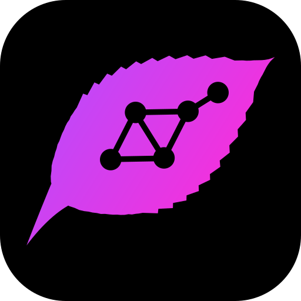

#  irch

Private, peer-to-peer community chat shaped like Discord, with no server:
spaces, channels, threads, DMs, voice and video calls. A small Rust core on
[iroh](https://iroh.computer), a terminal client, and one app for desktops,
Android and iPhones.

## Install

Each keeps itself up to date.

```sh
irm https://github.com/cab-ucf/irch/releases/latest/download/install.ps1 | iex  # Windows
curl -fsSL https://github.com/cab-ucf/irch/releases/latest/download/install.sh | sh  # macOS, Linux
```

- **Android**: open [irch.apk](https://github.com/cab-ucf/irch/releases/latest/download/irch.apk)
  on the phone, or track this repo in [Obtainium](https://obtainium.imranr.dev).
- **iPhone**: [irch.ipa](https://github.com/cab-ucf/irch/releases/latest/download/irch.ipa)
  in [AltStore](https://altstore.io) or [SideStore](https://sidestore.io)
  (updated by hand), or TestFlight once releases have an App Store
  Connect key.
- **Storage node** (always on): a space's *Storage Nodes → Run one on this
  computer*, or `install.sh … | sh -s -- --server`. Add `--push-relay
  https://irpush.you.example` so its devices home on irpush's quiet
  relay, not a stock one.
- **NixOS**: `inputs.irch.url = "github:cab-ucf/irch";` and
  `irch.nixosModules.default` among the modules: the app and a storage
  node, kept up to date (checked against irch's key, built by Nix; the
  newer of the latest release and the flake's own runs).
  `services.irch.pushRelayFile` for irpush's relay: a file holding
  `https://irpush.you.example`. `services.irch.enable = false;` leaves the node out (a
  laptop: keep it on a computer that is always on). Sway: `exec irch-app
  --hidden` in its config (it skips XDG autostart) and a tray in the bar
  (waybar's).
- **From source**: `cargo run --release -p irch` (terminal, `--serve` for a
  storage node); `cd app && cargo tauri dev` or
  `cargo tauri android build --apk`; on a Mac, `cargo tauri ios init`,
  then `cargo tauri ios dev`. Linux needs webkit2gtk-4.1, gtk3,
  libsoup3, ALSA (libasound2) and, for calls, gstreamer plugins base,
  good, bad and libav.

## Push for Android phones

Every storage node is a push server, with no setup and no Google: an
Android phone without a UnifiedPush app pairs with one it knows (its own
first) through [irpush](https://github.com/cab-ucf/irpush), and keeps one
quiet socket instead of a doorbell. That socket is the phone's one irpush
device, shared by every irpush app on it (irpush's Android library: the
first installed holds it); irch joins it into its storage node's mesh
beside theirs. Each ring is sealed end to end
(post-quantum) and always the same size. Stock iroh relays ping every 15 s,
which keeps a phone's radio awake; irpush's patched relay pings after
130 min, and is the default (irpush.cxn.center). Your own:
`IRCH_PUSH_RELAY=https://irpush.you.example` (default: irpush.cxn.center).

## On the web

```sh
irch --web    # or --web 0.0.0.0:4724; with --headless's other flags
```

Your own node serves the app's page to your browser, and keeps the keys:
the browser holds only a token, in the link's `#`, which never reaches a
server. It prints two links (to a terminal; else into `web` in its
folder): `http://127.0.0.1:4724/#TOKEN` on that computer, and
`https://cab-ucf.github.io/#ID;t=TOKEN` from any browser, through
[irp](https://github.com/cab-ucf/irp)'s static page, whose service worker
reaches the node over iroh (end to end, by relay, no open port). Both
are as good as your account: delete `web-key` there for new ones. Calls
work in a browser that has WebCodecs; Typst math shows as TeX. The page
holds nothing open while hidden (except in a call), so nothing rings
there then; the node itself is an always-on device of yours (`--link`).

## Features

- Spaces with channels (admins drag them into order), threads and named
  rooms, replies, reactions, edits, pins, @mentions, Markdown with code
  highlighting and Typst or LaTeX math, `||spoilers||`.
- DMs, voice messages, files sealed in chunks and kept by storage nodes
  (to 5 GB; more with the node's `--big-password`), or shared from your
  device at any size; previews of images, audio, video, PDFs.
- Photos, voice and short videos (to 25 MB) wait on the space's storage
  nodes whoever sent them, so everyone sees them inline, sender away.
- Voice and video calls with screen sharing; a DM call rings like a phone.
  The caller hears ringback only once the other device rings, and sees
  when it is not getting through; a DM shows when it reached their device.
- Notifications on desktops and phones, per space: all, @mentions or none.
- Search on this device, Ctrl+K switcher, drafts per channel, vim keys
  as in the terminal (Esc, then `j`/`k`, `l`/`h`, `J`/`K`, `r`, `e`, `dd`,
  `?`; off in Settings), swipe gestures on phones.
- The terminal client is modal like vim: counts, `gg`/`G`, `/` and `n`,
  `:` commands, `l`/`h` into and out of threads, `J`/`K` channels, `?`.
- A DM closes (✕) to a greyed, folded *Closed* list and comes back with
  its next message; deleting it is separate (its menu, or `:leave`).
- Contacts (the people icon by *Direct messages*): everyone from every
  space and DM, most messaged first, searchable. *My contact code* (or
  `:contact`) is a code or QR: whoever adds it can DM you, no space shared.
- How far each of yours went: only here (no connection), only here
  (nobody took it yet), ✓ left here, ✓☁ kept by a storage node, ✓✓ on
  their device, ✓✓ lit once read; in a group, how many of how many.
  Devices ack what is dialed to them; relays keep nothing, so ack nothing.
- A deleted message can be undone for a few seconds (*Undo*, or `u`).
- *Check connections* (Network use, `irch --doctor [who]`, and on its own
  in a call not getting through): our relay, and each of someone's
  devices and push servers reached and timed, direct or relayed. Nothing
  rings.
- *Network use* (My Account, or `:usage`): when iroh ran, what it sent and
  received, and the pushes that woke it, from a log written only as that
  changes; on Android, the app's own packets (irpush's too) and battery.
- A call rings all of someone's devices; answered on one, the others
  stop, and none of the caller's own ring. Declined (in the app or on a
  phone's call screen), its caller hears so and hangs up, and the
  others stop too.
- *Relay key* (Network use): a key from whoever runs a relay lifts its
  speed limit for big transfers that cannot go direct. Each saved key
  shows what its relay says of it now (takes it, does not know it, or no
  answer), with Remove.
- Several profiles per device, linked devices (listed, with when each
  last wrote), invisible mode, private notifications, themes (Neon,
  Midnight, Nord, UCF, Light).
- Owners hand a space on (*Make Owner*); a lost or stolen device's
  identity is retired everywhere (*A device was lost or stolen*).
- *Note to self*, first among DMs: notes, secrets and files of any size,
  on every device of yours and kept by your storage nodes, nobody else's
  (your own space, sealed with a key only your devices hold).
- *Short code* (under an invite, or Link a device): `k7m-x9q-p3a`, good
  for a minute and one try, typed into Join or Link this device. It hands
  the full code over sealed to that device (post-quantum), found by a
  throwaway identity the code stretches to (Argon2id). An optional
  password, told apart from the code, locks it once more.
- Invites show what they are to before you join; links show where they
  go before they open; a message only on this device says so.
- A camera button takes a photo and sends it: never in the gallery, no
  location in it. Link previews are made by the sender's device as it
  sends (the site sees only the sender; off in My Account).
- Devices and storage nodes have names: asked at first start (the
  computer's hostname; a storage node's, `hostname-storage`), renamed in
  My Account or Storage Nodes, where a storage node can also be removed
  (and stopped, if it runs here). My Account shows the version.
- On phones, a call of two fills the screen, upright, like FaceTime.
- In a call, where it is heard: Standard (a phone's earpiece, else the
  system's output), Speakerphone or Bluetooth (its microphone too), each
  press the next this device has; kept for the next call.
- *Add to notes*: a message or thread lands in a
  [loroh](https://github.com/cab-ucf/siroh) note as a task, event or quote,
  with an `irch://` link back; on phones through loroh, which asks first.
- *Copy Link* on a channel or message (`Y` in the terminal): what a
  [tydig](https://github.com/cab-ucf/tydig) project or a note points at.
- `irch --api`: JSON calls on stdin, answers and events on stdout, for bots
  and bridges; a [tydig](https://github.com/cab-ucf/tydig) project's
  Discussion is a channel this way.

## How it works

```text
op    = Profile | Rename | Channel | Order | Role | Post | Edit | React | Pin
      | Topic | Rekey | Back | Host | Hold | Knock | Joined | Left | Storage
      | Store | Push | Typing | Here | Call | Gone (the last four: live)
env   = { epoch tag, time, XChaCha20-Poly1305(author ‖ device ‖ sig ‖ op) }
space = a grow-only set of envs;   state = a deterministic fold of it
```

- **Everything is ciphertext.** Relays, storage nodes and the network see
  an epoch tag, a time and bytes.
- **Bans change the key**, boxed to each remaining member with X-Wing
  (ML-KEM-768 + X25519); a `Back` op keeps history readable for members.
  Ops sign their epoch, so none is sealed again under another.
- **A key is a room.** The gossip topic and each sync's proof derive from
  the current key: a rekey leaves whoever it cut off outside, unable to
  hear or fetch even ciphertext. Syncs are signed for the device asked.
- **Authority is a fold** in `(time, id)` order, so every replica agrees in
  any delivery order; only current admins' rekeys count.
- **One seed is you** on every device; a private space records what you
  joined, so linked devices follow each other.
- **Storage nodes keep ciphertext, never keys**, so messages wait while
  everyone is offline. They answer their owners, the devices their owners
  vouch for, and holders of the current key; they keep only the epochs
  their owners name, within a daily budget.
- **Threads are channels** named by a message's id: no extra protocol.
- **Calls are a mesh** over QUIC: Opus datagrams; video in the newest
  codec every listener decodes (AV1, VP9, then VP8 or H.264), one stream
  per group of pictures, so a slow peer skips to the newest keyframe.
- **A call's voice is native** (not on iPhones): WebRTC's echo canceller
  (sonora) hears exactly what plays, so both sides talk at once on a
  speaker; a web view's cannot. Opus in the page's frames: they mix.
- **Voice messages are Opus in Ogg**, played by decoding them in the app:
  the same in every web view, seekable, the right length.
- **Sync** compares per-day fingerprints, then sends only missing envs.
- **Phones and desktops sleep, holding nothing open.** Out of sight a
  minute (a desktop: with a storage node pushing to it), the node stops. Whoever writes or calls rings each member's phone with the
  sealed op itself, and the phone shows it from a phonebook its node left
  (each space's key, names, levels) and keeps it for the node to fold
  later: a wake starts no node and opens no connection. Android phones
  are rung with a UnifiedPush app such as ntfy, through it; else through
  irpush, from a storage node (below), on one socket with heartbeats as
  long as the network allows; else, at a battery's cost, through irch's
  own doorbell. iPhones catch up when opened, and a call keeps irch up.
- **Push servers** are storage nodes, any of them, through irpush. Phones
  ask the storage nodes they know (theirs, their spaces') for a ticket,
  join the phone's one irpush device into that mesh once (each of its
  owner's storage nodes: rung all at once, a ring gets through while any
  is up), and give it their device and a ring token per space and
  epoch. Members ring with those as with a doorbell, every route of a
  phone at once; irpush carries the ring sealed end to end, one size, so
  its relay learns when and nothing else, and the phone shows it as it
  lands. The push server keeps a ring for a phone that is off a day;
  storage nodes and members keep everything, synced when irch opens.
- **Traffic is one op per state change.** A device says `Here` as it
  joins a space's mesh and `Gone` as it leaves or idles 10 minutes; each
  device already there answers once with its call (none, mostly); in use,
  it says `Here` again at most every 10 minutes, and others drop a device
  unheard from 20. Typing is said as the input fills and as it empties.
  A call is said as it starts, and a ring for one starts the node at once,
  so it connects as it is answered.
  Open links are pinged every 5 s (iroh's fixed rate), so irch holds them
  only while in sight or in a call; asleep, a device holds irpush's socket
  alone. A device holds one relay at a time, best first: its storage
  node's, then irpush.cxn.center (both irpush's, pinged hours apart),
  then iroh.cxn.center, then n0's;
  a minute without it, the next; every half hour, the best again if it
  answers. Relays are open, so anyone reaches anyone homed on any of them.
  While running, iroh times its relay over https every 20–26 s: without
  that it has no home, and no one reaches it but over a LAN. No
  captive-portal or DHT probing.

| network | terminal (app env) | who else is involved |
|---|---|---|
| default | | relays irpush.cxn.center, then iroh.cxn.center (or a storage node's open relays first), then n0; n0 DNS |
| own relays | `--relay URL` (`IRCH_RELAY`) | your relays |
| LAN only | `--lan` (`IRCH_LAN=1`) | nobody (mDNS) |

## Limits

- No forward secrecy inside an epoch; keys rotate on bans and on request.
- Authors date their own ops (ten minutes ahead at most): a demoted
  admin's backdated bans and renames stand until undone.
- A linked device is you: lost, it can only be retired with the whole
  identity, not alone; you then start a new one and rejoin.
- Signatures are Ed25519; stored data is post-quantum, transport is not.
- Peers see each other's addresses, relays see endpoint ids and traffic,
  storage nodes see sizes, times and devices.
- A member's UnifiedPush server learns when each member writes, and from
  where. A push server learns that much, and which spaces a ring is for;
  irpush's relay, when and the phone's address. Doorbell codes are per
  space and die with a rekey.
- Presence is said, not polled: a device that vanishes without `Gone`
  (its battery dies) looks here up to 20 minutes.
- Call frames reach the system web view's video decoders.
- Calls are for a handful of people; Macs and iPhones need WebKit 26.
- An iPhone in the background is not told of messages: Apple's push is a
  server.
- Android's installer takes full-screen calls back from an app installed
  from a file, updates too: irch asks again after each update.
- Any member can have the space's storage nodes keep sealed files up to
  25 MB each, 4 GB a day for the space; a ban stops them.
- A storage code is a password. A first install trusts GitHub's TLS
  (checked against irch's key where `minisign` exists); every update is
  checked. Unaudited.

## Later, maybe

Optional, and only if they stay simple:

- Route through Tor or Nym, so members and relays never see an address
  (relays over TCP; direct QUIC would be off then).
- Rekey on a schedule, and per-sender key chains within an epoch: a
  leaked key would then reveal little before or after it.
- Safety numbers to compare in person; per-device keys, so one lost
  phone can be removed alone.
- A password lock on a space, on this device (its view and its keys at
  rest).
- Spaces apart: today each has its own keys, gossip, storage and doorbell,
  but one identity and device id across all, so members of two spaces can
  tell it is the same person (Profiles keep identities apart).
- An outside audit.

## Layout

| | |
|---|---|
| `core/` | ops, crypto, fold, logs, sync, node, the app's JSON API |
| `tui/` | `irch`: terminal client, `--serve`, `--install`, `--web` |
| `app/` | Tauri 2 shell; `ui/` the page; `gen/android` the Android project; `gen/apple`, generated |

Prior art: Quiet, Keet, Briar, Cwtch, SimpleX, Jami, p2panda;
calls follow n0's iroh-live. GPL-3.0-or-later.
